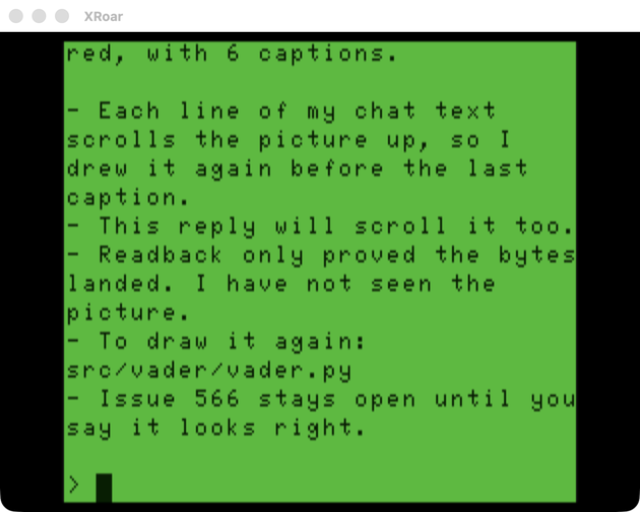

# CoCo Terminal for Claude Code

A dumb terminal for the TRS-80 Color Computer 2B, written in Bare Naked Forth, that lets you talk to Claude Code on your Mac from the CoCo keyboard. Replies come back in true lowercase on the MC6847T1 VDG, wrapped to 32 columns. Claude can also read and write the CoCo's memory directly, so it can draw on the screen.



## How It Fits Together

```
CoCo (XRoar)                         Mac
terminal.fs  <-- Becker port -->  tools/cocoterm_bridge.py  -->  claude -p
 $FF41/$FF42     TCP 65504              |
                                        +-- control port 65505 <-- tools/cocoterm_mcp.py
                                                                    (peek / poke tools)
```

- The CoCo program is a **dumb terminal**. It sends each key as you type it and draws whatever comes back.
- The **bridge owns the line**: it echoes, handles backspace, submits on ENTER, runs one `claude -p` turn per line, and streams the reply back reflowed to 32 columns of plain ASCII.
- Each turn resumes the same Claude session (`--resume`), so the conversation has memory until the bridge restarts.

## What It Demonstrates

- **T1 true lowercase** via `lib/console.fs`: setting `$FF22` bit 4 turns on the MC6847T1's full 7-bit character set, plus a scrolling console with CR, backspace and clear screen.
- **Becker port I/O** via `lib/becker.fs`: two registers, `$FF41` (status, bit 1 = byte waiting) and `$FF42` (data).
- **Non-blocking keyboard**: the kernel `KEY` blocks, so the terminal polls `KEY?` and sends a key only when the value changes. Letters are sent lowercase unless SHIFT is held.
- **VSYNC-timed cursor blink** without blocking: it counts frames using the PIA0 CRB bit 7 flag.
- **An ESC command channel** on the same byte stream, used for memory peek and poke.

## Controls

| Key | Action |
|-----|--------|
| Letters | Sent lowercase; SHIFT + letter sends uppercase |
| ENTER | Submit the line to Claude |
| LEFT | Backspace |
| BREAK | Cancel the reply in progress |
| CLEAR | Clear the screen |

## Running It

The bridge must start first. XRoar's Becker port is a TCP *client* that connects once, when the cartridge is created, so the bridge has to be listening before XRoar starts.

```sh
# Terminal 1: the bridge
cd src/terminal && make bridge

# Terminal 2: the CoCo
cd src/terminal && make run
```

`make run` launches `xroar -machine coco2bus ... -cart rsdos -cart-becker`. The plain RS-DOS cartridge carries the Becker port without HDB-DOS, and the T1 VDG in `coco2bus` supplies the lowercase.

### Bridge options

Run `python3 tools/cocoterm_bridge.py --help` for the full list.

| Option | Default | Meaning |
|---|---|---|
| `--cwd DIR` | current directory | Directory Claude works in |
| `--permission-mode MODE` | `plan` | `plan` lets Claude read but not change files; `acceptEdits` lets it edit files |
| `--no-api-key` | off | Unset `ANTHROPIC_API_KEY` for Claude so it uses your claude.ai login. An API key in the environment otherwise takes precedence. |
| `--model NAME` | Claude Code default | Model for each turn |
| `--allowed-tools LIST` | none | Passed to `claude --allowedTools` |
| `--cps N` | 400 | Output characters per second. XRoar drops Becker bytes if they arrive too fast. |
| `--nc` | off | Test with `nc 127.0.0.1 65504` from a normal terminal instead of XRoar |
| `--selftest` | | Run the reflow and sanitizer checks and exit |

For example, to let Claude edit files using your claude.ai login:

```sh
python3 tools/cocoterm_bridge.py --cwd ~/github/coco --no-api-key --permission-mode acceptEdits
```

Nobody can approve a permission prompt from the CoCo, so tools that would ask for approval are refused.

## Memory Tools

Claude gets two MCP tools, `peek` and `poke`, that read and write live CoCo memory. It uses them for things like drawing SG4 pictures straight into video RAM (see `src/vader`). The bridge carries them as ESC frames on the Becker link:

| Frame from the bridge | CoCo reply |
|---|---|
| `ESC P addrH addrL n` | `ESC` followed by the `n` bytes read |
| `ESC W addrH addrL n data...` | `ESC` |

Frames carry at most 64 bytes; the bridge splits bigger requests. Tool calls don't print anything on the CoCo screen, so drawings aren't scrolled away. Claude's own reply text still scrolls the screen when the turn ends.

## Known Limits

- **No key auto-repeat**, and pressing a new key while another is held can be missed (#562).
- **32x16 only.** A CoCo 3 40/80-column version is #559, and cursor-addressing escapes are #558.
- **T1 font quirks:** `_` draws as a left arrow, and `{ | }` look like `( ! )`.
- **Needs a T1 machine for lowercase.** On a plain MC6847 (CoCo 1, early CoCo 2), lowercase text shows as inverse-video garbage.
- **The console lives in `lib/`, not the kernel.** The ROM-mode kernel has about 125 bytes free (#561).

## Also Included: console-test

`console-test.fs` is a visual check for `lib/console.fs`. It prints 20 numbered lines to show scrolling, then a lowercase and punctuation line, then a backspace test. Build it with `fc.py` and run it on `coco2bus` without the bridge.
