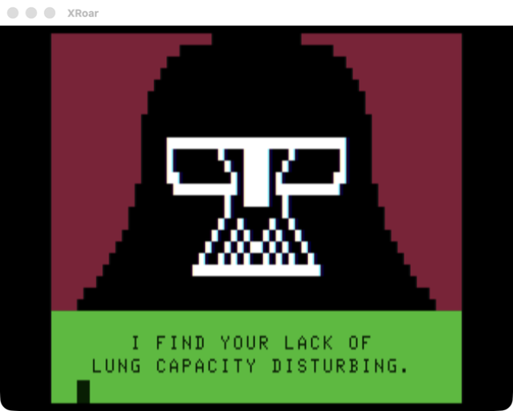

# Darth Vaper

An anti-vaping public service announcement drawn on the CoCo text screen by Claude Code through the CoCo terminal (`src/terminal`). A Darth Vader helmet in SG4 semigraphics fills the top twelve rows, and a series of captions plays underneath in true lowercase-capable T1 text.



## How It Works

There is no Forth program here. `vader.py` generates the screen bytes on the Mac, and Claude pokes them into live video RAM with the terminal's `poke` tool while the terminal is running.

- **The helmet** is 64x24 SG4 pixels on rows 0-11. Only the left half is drawn as ASCII art (`.` red, `o` buff, `#` black) and mirrored to make the right half. Each 2x2 block of pixels becomes one SG4 character: `$80 | color << 4 | bits`. If a cell mixes red and buff, buff wins.
- **The captions** use rows 12-15. Each caption is four lines centered in 32 columns, converted to T1 screen codes.

Running the script prints the bytes as hex, ready to poke:

```sh
python3 src/vader/vader.py
```

```
$0400 <128 bytes of helmet>     four lines for the image, $0400-$057F
...
$0580 <128 bytes of caption>    one line per caption frame, all at $0580
```

To play it, ask Claude in the terminal to poke the image lines, then each caption frame in turn with a pause between them.

## Notes

- Claude's own reply text scrolls the screen when a turn ends, so the picture only stays clean while a turn is running. Tool calls themselves print nothing (#565).
- The captions are all uppercase, so they also display correctly on a plain 6847.
